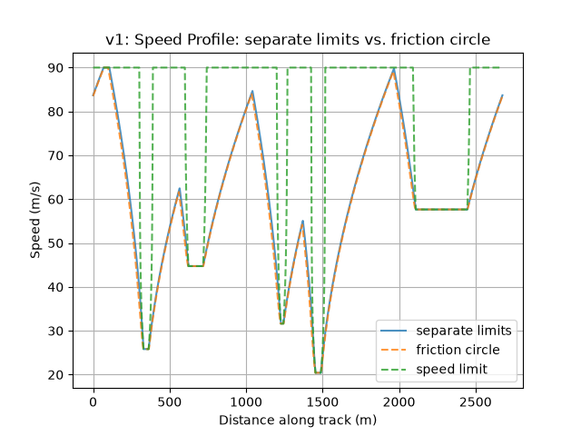
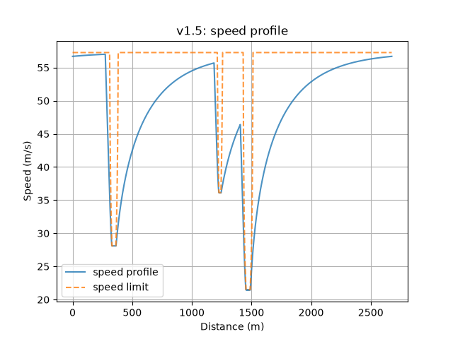
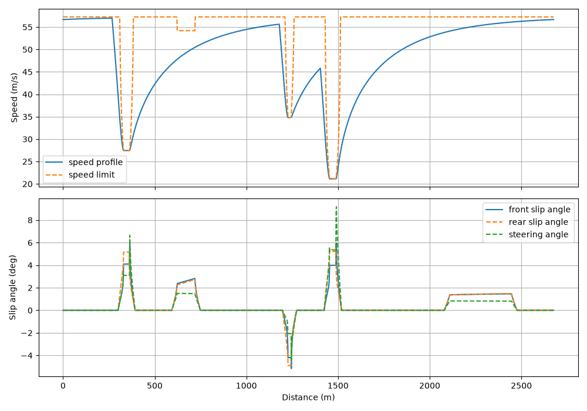
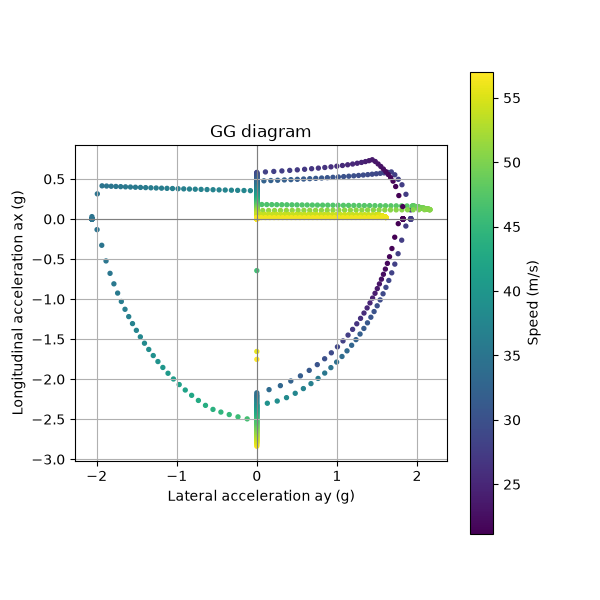

# Lap Time Simulator
 
A Python-based vehicle lap time simulator built from first principles, applying
vehicle dynamics to model velocity, acceleration, braking, and cornering performance.
 
## Overview
 
This project simulates a vehicle's speed around a track by combining:
- A free-body derivation of a vehicle's traction, braking, and cornering limits
- A point-mass vehicle model with a combined friction-circle tyre constraint
- A steady-state bicycle model with per-axle grip, longitudinal load transfer
  and load-sensitive tyres
- A forward/backward speed-profile solver to compute a physically achievable
  speed trace and resulting lap time
- The effects of downforce, drag, and rolling resistance
- Magic Formula outputs: the slip angles and steering angle along the lap.
The project is developed in versions, each kept in its own folder so the
progression can be followed.
 
## Versions
 
### v1 - Point-mass model with friction circle
- Track built from straight, corner and transition segments, split into 1 m steps, each with its curvature (1/radius, zero on straights). In a transition (clothoid), the curvature changes linearly between the two segments it joins
- Corner speed limit from the tyre grip: v = √(μg/κ), capped at a fixed top speed
- Forward pass (acceleration) and backward pass (braking), combined by taking the lower speed at each point
- Two models compared:
  - Separate limits: fixed maximum acceleration, braking and cornering, each treated independently
  - Friction circle: acceleration, braking and cornering share the same tyre grip, so the car cannot brake or accelerate fully while cornering
### v1.5 - Powertrain and aerodynamic forces
- Engine limit: constant maximum drive force below the motor's base speed, constant power above it (F = P/v)
- Aerodynamic drag, downforce and rolling resistance
- Downforce adds tyre load, so the corner speed limit rises with speed; it is still solved exactly with a formula
- Top speed computed from the power–drag balance instead of a fixed cap
- Lap time calculated using the average speed over each segment
- Vehicle parameters grouped in a `Vehicle` dataclass
### v2 - Bicycle model with load-sensitive tyres
- Steady-state bicycle model: the lateral force each axle must produce is set by the cornering acceleration and the CG position (Fyf = m·ay·b/L, Fyr = m·ay·a/L), so the car is limited by whichever axle saturates first
- Axle loads come from the static weight distribution, the downforce split by the aero balance, and longitudinal load transfer ((m·ax + drag)·h/L: drag acts at the CG height, so it also moves load to the rear)
- Load-sensitive tyres: the friction coefficient μ decreases linearly with tyre load
- Per-axle friction ellipse: each axle shares its grip between cornering and braking or accelerating
- Rear-wheel drive, and braking split between the axles by the brake bias
- Front axle check under acceleration: accelerating unloads the front, which still has to hold its share of the cornering force
- Corner speed limits found numerically with Brent's method: with load sensitivity, the equation can no longer be solved with a formula. At steady speed the rear tyres must also push against drag and rolling resistance, so their cornering grip is reduced with the friction ellipse
- Load transfer and grip depend on each other: the acceleration moves load between the axles, which changes the grip, which changes the maximum acceleration. Under acceleration this is solved by fixed-point iteration (started from the engine limit); under braking by bisection, because the fixed-point iteration sometimes does not converge there
- Outputs (`Outputs.py`): a lateral Magic Formula tyre model, with its peak equal to the axle's grip limit (D = μ·Fz), is inverted to find the slip angle each axle needs to produce its lateral force. The steering angle follows from the steady-state bicycle model: δ = L·κ + αf − αr

## Results
 
Sample circuit: a closed 2676 m lap with five corners (radii 40, 120, 60, 25 and 199.3 m; the 60 m corner turns right), each with a 30 m clothoid transition before and after it. All lap times are for a flying lap: the start speed is found so that the car crosses the line at the same speed it started with.
 
| Model | Lap time |
|---|---|
| v1 - separate limits | [49.50] s |
| v1 - friction circle | [50.33] s |
| v1.5 | 57.20 s |
| v2 | 57.69 s |
 



 
In v1 the car accelerates at a constant rate. In v1.5 the acceleration drops as speed rises, because above the motor's base speed the drive force falls as P/v while drag grows with v², so the speed levels off towards a top speed set by power and drag rather than by a fixed cap.
 
The car can also brake later in v1.5, since drag helps slow it down and downforce adds grip at high speed.
 
Downforce raises the corner speeds since it increases the normal force and in consequence, the maximum grip, and because it grows with v², the gain is much bigger in fast corners than in slow ones. As a result, in the two fast corners (120 m and 199.3 m), the grip limit allows a speed even higher than the car's top speed, so these corners don't limit the car at all: it is limited by power there.
 
From v1.5 to v2, the straights and fast corners are almost unchanged, since both versions use the same power, drag and downforce. Most of the difference comes from the three slow corners, where v2's corner speeds are lower, so the car brakes earlier and accelerates out from a lower speed. Three effects are new in v2. First, each axle has its own grip limit instead of the grip being pooled for the whole car, so the car is limited by whichever axle saturates first. Second, longitudinal load transfer: accelerating moves load to the rear axle and braking moves it to the front, and drag, acting at the CG height, also moves load to the rear. Third, tyre friction now decreases with load.
 
To measure each effect, `compare.py` turns them off and reruns the lap (the v1.5 row comes from `v1.5/main.py`).
 
**Previous results** (first sample circuit: 1800 m, corners with no transitions, drag not included in load transfer): load sensitivity lowered the R40 limit far more than the axle split did (28.05 → 27.37 m/s, against 28.12 → 28.05 m/s), turning off load transfer made the lap 0.23 s slower, and setting the brake bias to 43 % brought the axle split only run back to almost the v1.5 lap time (41.55 s vs 41.53 s), so the time it lost came from the brake bias.
 
**Current results** (closed 2676 m circuit with clothoid transitions; drag included in both the corner speed limit and the load transfer):
 
| Run | Lap time | R40 corner limit (40 m radius) |
|---|---|---|
| v1.5 | 57.20 s | 28.12 m/s |
| v2 | 57.69 s | 27.45 m/s |
| v2, no load transfer (h = 0) | 57.92 s | 27.32 m/s |
| v2, no load sensitivity (k_load = 0) | 57.52 s | 27.81 m/s |
| v2, axle split only (h = 0, k_load = 0) | 57.56 s | 28.05 m/s |
| v2, axle split only, brake bias 43 % | 57.33 s | 28.05 m/s |
 
- **Load sensitivity:** it lowers the R40 limit far more than the axle split does (by 0.36–0.73 m/s, against 0.07 m/s), and turning it off makes the lap 0.17 s faster.
- **Load transfer:** turning it off makes the full model 0.23 s slower.
- **Brake bias:** setting the brake bias to 43 % (the front axle's share of the weight) recovers most of the time lost by the axle split (57.56 → 57.33 s), but not all of it (v1.5: 57.20 s). A likely reason is that the car now brakes while turning into the corners, and a single fixed brake bias can't suit both straight-line braking and braking while cornering.
- **Drag and load transfer interact:** drag now moves load to the rear even at constant speed, so load transfer also changes the corner limits. In the full model the rear limits (it is the most loaded axle, so it has the lowest friction coefficient), and the extra rear load raises the R40 limit (27.32 → 27.45 m/s). Without load sensitivity the front limits, and the same load shift lowers it (28.05 → 27.81 m/s). That is why turning off load transfer only costs 0.04 s when load sensitivity is off.
## Outputs
 


 
`Outputs.py` finds, at each point of the lap, the slip angle each axle needs to produce its lateral force, by inverting the lateral Magic Formula with Brent's method between zero and the peak slip angle. The slip angles are signed, so the right-hand corner gives negative angles. The steering angle then follows from δ = L·κ + αf − αr: the geometric steer plus the difference between the front and rear slip angles.
 
- **Balance:** in the slow corners the rear slip angle is larger than the front one, so the car needs less steering than L·κ: it oversteers. The rear is the more heavily loaded axle, so with load sensitivity it has the lower friction coefficient. In the fast corners the front slip angle is slightly larger: drag moves load to the rear and the downforce is slightly more rearward than the weight distribution (58 % against 57 %), so the car understeers slightly at high speed.
- **Corner exits:** at the start of each exit the front slip angle briefly reaches its peak. The car starts accelerating while still turning, accelerating unloads the front, and the front axle check limits the acceleration so that the front is exactly at its grip limit (power understeer).
- **GG diagram:** braking on the straights reaches about −2.8 g at high speed. In the entry transitions the points follow the friction ellipse from braking to cornering (trail braking), and on the exits from cornering to acceleration, where the top of the envelope is flat because the car is power-limited. The envelope grows with speed because of the downforce.
## Limitations
 
- v1 and v1.5 are point-mass models: no yaw dynamics, steering, tyre slip angles or load transfer
- v2 is quasi-steady-state: the car is assumed to be in steady cornering at each point, so yaw transients (corner entry and exit) are ignored, which makes lap times slightly optimistic
- The bicycle model lumps each axle into a single tyre, so lateral load transfer is not modelled
- Linear load sensitivity law, with the same μ in the lateral and longitudinal directions
- Combined slip uses a friction ellipse per axle rather than the Magic Formula combined-slip functions
- The outputs are lateral only: they don't reduce the lateral grip when the tyre is also braking or accelerating, and the peak slip angle doesn't change with load
- Aero balance is constant with speed
- The sample circuit is defined by its curvature only, not by real x-y coordinates
- Vehicle parameters are placeholders, not a specific real car
## Roadmap
 
- [x] v1: Point-mass simulator with friction-circle tyre model and forward/backward speed-profile solver
- [x] v1.5: Power-limited traction (constant-force and constant-power regions)
- [x] v1.5: Aerodynamic drag, downforce and rolling resistance
- [x] v2: Bicycle model with per-axle grip, longitudinal load transfer and load-sensitive tyres
- [x] v2: Magic Formula outputs: slip angles and steering angle along the lap
- [ ] Lateral load transfer, with front/rear roll stiffness distribution
- [ ] Real circuits imported from centreline coordinates, with curvature computed from x-y data
- [ ] Validation against real track lap time data
- [ ] Suspension effects
## Project structure
 
v1/
track.py - track definition and curvature calculation
vehicle.py - vehicle parameters, tyre limits, and forward/backward solver
main.py - runs both models and plots the results
v1.5/
track.py - track definition and curvature calculation
vehicle.py - Vehicle dataclass: forces and acceleration limits
solver.py - corner limits, forward/backward passes and lap time
main.py - runs a full simulation and plots the results
V2/
Track.py - track definition and curvature calculation
Vehicle.py - Vehicle dataclass: axle loads, load-sensitive tyres, per-axle grip limits and the lateral Magic Formula
Solver.py - corner limits, forward/backward passes with load transfer, flying lap and lap time
Outputs.py - slip angles and steering angle along the lap
Main.py - runs a full simulation and plots the results, outputs and GG diagram
Compare.py - turns off load transfer and load sensitivity one at a time to measure their effect
 
 
## Running it
 
```bash
git clone https://github.com/charly-james/lap-time-simulator.git
cd lap-time-simulator
python -m venv venv
venv\Scripts\activate          # Windows
pip install -r requirements.txt
cd V2                          # or cd v1.5, cd v1
python Main.py
```